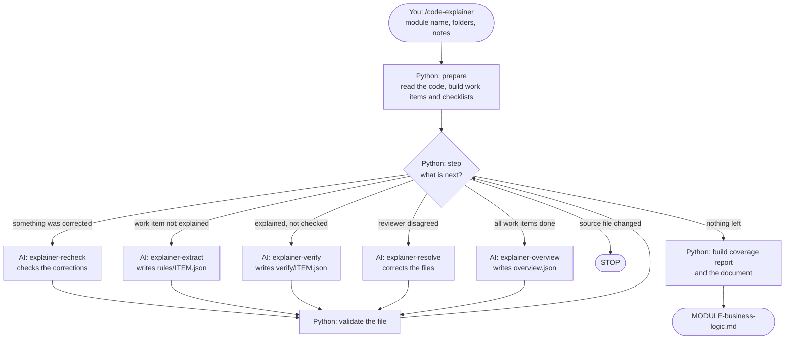

# Code Explainer - how it works

Code Explainer reads the source code of one module (Java, SQL and configuration files) and writes a business requirements document for it. This page explains the flow: who does what, in what order, and where each file fits.

## The idea in one paragraph

Two kinds of worker take turns. **Python** does everything that can be done by fixed logic: it cuts the code into pieces, makes a checklist, decides the next step, checks every result, and builds the final document. **AI agents** do everything that needs understanding: they read the code and write what it means in business language. Python never writes business text. The AI never decides what happens next.

## Who is who

| Part | Folder | Kind | Job |
|---|---|---|---|
| Chat command `/code-explainer` | `prompts/` | AI (main chat) | Starts the run. Repeats: ask Python for the next task, start the named agent, wait. |
| `explain.py` | `scripts/` | Python | The controller: inventory, next step, validation, retries, safety checks, final document. |
| `java_index.py` | `scripts/` | Python | The reader: splits Java, SQL and configuration files into pieces and lists what must be explained. |
| `explainer-extract` | `agents/` | AI | Reads the code of one work item. Writes requirements, rules, scenarios and the flow. |
| `explainer-verify` | `agents/` | AI | Second reviewer. Checks everything the extract agent wrote against the code. |
| `explainer-resolve` | `agents/` | AI | Runs only after a disagreement. Reads the code and decides who is right. |
| `explainer-recheck` | `agents/` | AI | Runs after a correction. Checks the corrected text against the code, so nothing reaches the document unchecked. |
| `explainer-overview` | `agents/` | AI | Runs once at the end. Writes why the module exists and groups the features. |
| Step instructions | `steps/` | Text for the AI | The detailed instructions and output format for each agent. |
| `config.json` | (package folder) | Settings | Where the source is, which folders make up each module, which models to use. |
| Results | `output/<MODULE>/` | Data | Everything the run produces. |

## The flow



Python is asked "what is next?" before every piece of AI work, and it checks the result after every piece.

## Step by step

### 1. Prepare (Python, no AI)

`python explain.py prepare AR --path src/com/acme/ar db/ar config/ar --about "..."`

- Reads every Java, SQL and configuration file in the module folders.
- Java: finds the methods and which method calls which. A group of methods that starts at one entry point is one flow.
- SQL: one piece for each procedure, function, trigger, view or table; other statements become script pieces.
- Configuration: blocks of settings.
- For each piece, lists what must be explained: every condition, every `case`, every error handler, every SQL statement, every calculation, every block of settings.
- Writes one **work item** file for each flow in `output/AR/work/`.
- Saves a fingerprint of every source file, to detect changes later.

### 2. Extract (AI)

Python prints a task such as:

```
AGENT: explainer-extract
TASK: Read steps/extract.md and follow it. Work item: output/AR/work/AR-001.json
```

The main chat starts that agent with that line. The agent reads `steps/extract.md` (which also sends it to `steps/common-rules.md`), reads the code lines named in the work item, and writes `output/AR/rules/AR-001.json` with:

- the overview, users and roles, preconditions, inputs and outputs;
- functional requirements ("The system shall ...");
- business rules, each with conditions, calculation, the origin of every value, and a worked example;
- the flow as boxes and arrows, and the scenarios through it (main, alternate, exception);
- questions for the business expert (SME) where the code is unclear.

### 3. Validate (Python, no AI)

Python checks the file. Some of the checks:

- Every item of the checklist is covered by a rule, or marked "no business rule" with a reason.
- The code lines a rule points to exist and contain the items it covers.
- Every requirement is a "shall" statement and rests on a rule; every rule has a requirement.
- Every arrow of the flow diagram is followed by at least one scenario; one scenario is the main one.
- Every unclear rule has a question for the SME.
- A value given as "fixed in the code" or "set in a configuration file" has its number in the code lines the rule points to.

If a check fails, the same agent gets the list of problems and corrects the file. After 6 failed attempts the work item is reported as stuck and the run goes on.

### 4. Verify (AI, clean context)

A second agent, which has not seen how the first one reasoned, reads the same code and then the rules file. It recalculates every example and gives a verdict (agree or disagree) on the flow, each requirement, each rule and each scenario. It also reports behaviour that no rule describes.

### 5. Resolve (AI, only after a disagreement)

A third agent reads the code at the disputed lines and decides: the reviewer was right (the file is corrected), the reviewer was wrong, or the code does not settle it (it becomes a question for the SME).

### 6. Recheck (AI, only after a correction)

Whatever the resolve step corrected or added has not been seen by a reviewer. A fourth agent, on a different model from the resolve step, checks each correction against the code and marks it agree or disagree. A disagree is not sent round again: it goes into the document as an open question for the SME, and that item keeps an empty second-check box.

### 7. Overview (AI, once)

When all work items are done, one agent reads a short index of all the flows (not the code) and writes why the module exists and which types of feature it has.

### 8. Build the document (Python, no AI)

Python reads all the files in `rules/` and `verify/` and writes `output/AR/AR-business-logic.md`.

## How Python knows the state

There is no database. Python looks at which files exist and whether they pass the checks:

| What exists for the work item | State | Next step |
|---|---|---|
| No rules file | `TODO` | extract |
| Rules file with problems | `EXTRACT_INVALID` | extract again, with the list of problems |
| Valid rules file, no verify file | `EXTRACTED` | verify |
| Verify file with problems | `VERIFY_INVALID` | verify again |
| Valid verify file with an open disagreement | `DISPUTED` | resolve |
| Disagreements settled, corrections not checked yet | `RECHECK` | recheck |
| Valid verify file, nothing open | `DONE` | - |

Because of this, a run can stop at any moment and continue later. Finished work items are skipped.

## What is in the final document

1. **Module overview** - why the module exists, the numbers at a glance, the types of feature.
2. **Glossary** - names in the code and their business meaning.
3. **Features** - one section for each flow, always in this order:
   overview, users and roles, preconditions, functional requirements (FR-01 ...), business rules (BR-01 ...), main flow with diagram, alternate and exception flows, inputs and outputs, open questions.
4. **Fixed business values** - values written in the code itself.
5. **All open questions for the SME**.
6. **Appendix A** - where each feature, requirement and rule comes from in the code (file and lines).

Each rule carries three marks: code-checked (passed validation), second check (the verifier agreed), SME confirmed (an empty box for the business expert).

## Files in `output/<MODULE>/`

| File or folder | Written by | Content |
|---|---|---|
| `work/` | Python | One work item for each flow: the code to read and the checklist. |
| `rules/` | AI (extract, resolve) | Requirements, rules, scenarios and flow for each work item. |
| `verify/` | AI (verify, resolve) | The verdicts of the second reviewer. |
| `overview.json` | AI (overview) | Module purpose and types of feature. |
| `runs/` | Python | Record of every step: time, instruction fingerprint, source fingerprints. |
| `module-info.md` | Python | Your notes about the module, given to every agent. |
| `coverage.md` | Python | How many checklist items are explained. |
| `<MODULE>-business-logic.md` | Python | The final document. |

## Safeguards

- **Nothing skipped:** the checklist comes from the code, not from the AI.
- **Second opinion:** every statement is checked by a different agent with a clean context, and every correction is checked again.
- **Exact values:** a number that is not in the cited code lines is rejected.
- **No guessing:** what the code does not show becomes a question for the SME.
- **Source protected:** the run stops if any source file changed since `prepare`.
- **No endless loop:** 6 attempts for each work item, then it is reported as stuck.
- **No secrets:** passwords and keys in configuration files are not copied into any output.

## Two ways to run it

| Way | Command | Who starts the agents |
|---|---|---|
| Copilot Chat, agent mode | `/code-explainer` | The main chat, one work item at a time. |
| Terminal with a model command-line tool | `python explain.py run AR --path ... --about "..."` | Python, several work items in parallel. |

Both use the same instructions in `steps/`, the same checks and the same document builder.

## Useful commands

Run these from the `scripts` folder.

| Command | What it does |
|---|---|
| `python explain.py selfcheck` | Checks the installation and the module folders. |
| `python explain.py status AR` | Shows the state of every work item. |
| `python explain.py validate AR-001` | Checks the files of one work item and lists the problems. |
| `python explain.py coverage AR` | Writes the coverage report. |
| `python explain.py build-doc AR` | Builds the document again. No AI is used. |
