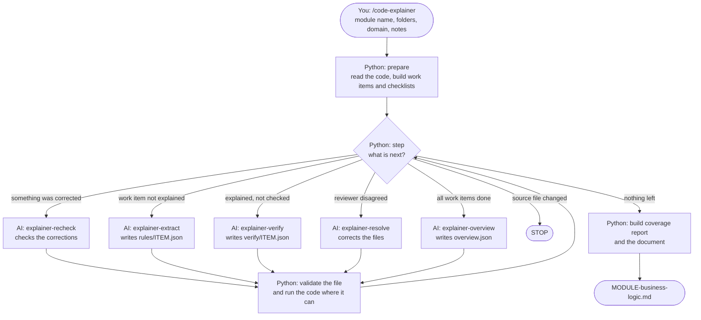

# Code Explainer - how to use it and how it works

Code Explainer reads the source code of one module (Java, SQL and configuration files) and writes a business requirements document for it: what the system does today, in plain English, with every statement linked to the lines of code it comes from.

This page has three parts:

1. **How to use it** - what you need, what you type, what you get, what to do when it stops.
2. **Where AI is used, where Python is used, and why.**
3. **How it works** - the flow, the checks, the files.

---

# Part 1. How to use it

## What you need

| You need | For what |
|---|---|
| Python 3.7 or newer | The tool itself. Nothing has to be installed with `pip`: the one library it uses is in `vendor/`. |
| An AI coding assistant | The reading and writing. Either GitHub Copilot Chat in agent mode, or a model command-line tool (the default in `config.json` is `claude`). |
| A JDK (`javac` and `java`) - optional | The execution check: running real code with the inputs of an example. Without it the check is skipped and the report says so. |
| Two or three sentences from the business team | The business domain of the module and what it is for. The tool does not guess this. |

## Set it up once

1. Copy this folder (`.github`, with `agents`, `prompts`, `steps`, `scripts`, `vendor` and `config.json`) into the project that holds the source code.
2. Open `config.json` and set `source_root`: the folder all module paths start from, written relative to this folder. If this folder is `<project>/.github`, use `".."`. The pipeline folder must be inside `source_root`, so that the AI can read both.
3. Open a terminal in the `scripts` folder and run:

   ```
   python explain.py selfcheck
   ```

   Every line must say `[ OK ]`. An `[INFO]` line about the execution check means no JDK was found; the tool still works.

## Document one module

### Step 1. Collect what the business team knows

| What | How you give it | Needed? |
|---|---|---|
| The business domain, for example "Accounts receivable", "Payments", "Order management" | `--domain "..."` | Yes, the first time |
| One or two sentences on what the module is for | `--about "..."` or `--about-file notes.txt` | Strongly advised |
| Business terms with their meaning, and the users and roles | `--terms-file terms.txt` | Optional |

Why this matters: names in old code are short and often wrong (`amt`, `flg2`, `procA`). The domain and the terms tell the AI which business words to use. Without them it would borrow words from the wrong business.

### Step 2. Run it - choose one of two ways

**Way A: GitHub Copilot Chat (agent mode).** Type `/code-explainer` in the chat. It asks for the module name, its folder, the domain and the notes. Then it works by itself: it asks Python for the next task, starts the agent Python names, waits, and repeats. A large module needs several hundred repetitions; that is normal.

**Way B: the terminal.** Python calls the model command itself, several work items at a time:

```
python explain.py run AR --domain "Accounts receivable" --path src/com/acme/ar db/ar config/ar --about "Works out what a customer owes."
```

- `AR` is a short name you choose for the module. It becomes the folder `output/AR` and the start of every id.
- `--path` lists the folders of the module (Java, SQL, configuration), relative to `source_root`. You give it once; it is saved in `config.json`.

Both ways use the same instructions, the same checks and the same document builder. Both can be stopped at any moment and started again with the same command: finished work is kept and skipped.

### Step 3. Read the result, in this order

Everything is in `output/AR/`.

1. **`coverage.md` first.** It answers "can I use the document yet?":
   - *Work items done (extracted and verified)* must be all of them.
   - *Files that were not read* must be empty, or you must know why those files hold no business logic.
2. **`AR-business-logic.md`** - the summary page. Each feature links to its own page in `features/`.
3. **Chapter 5, open questions for the SME.** Each one is something the code does not settle.

### Step 4. Let the business expert (SME) review it

The document is a checked draft of the requirements, not the signed-off requirements. Every business rule carries these marks:

| Mark | Set by | Meaning |
|---|---|---|
| Code-checked ✔ | Python | The rule points to real code lines, covers its checklist items, and its fixed numbers are in those lines. |
| Run against the code ✔ | Python | The real code was run with the inputs of an example and returned the documented result. Only for code that can be run on its own. |
| Second check ✔ | AI | A second agent, which did not see how the first one reasoned, compared the rule with the code and agreed. |
| SME confirmed ☐ | A person | Empty on purpose. The SME ticks it. Only then is the rule a requirement. |

The SME answers the open questions, confirms the reasons marked "to be confirmed by the SME", and ticks the boxes.

### Step 5. Calibrate once, on a module the SME knows well

Before you rely on the tool for many modules, measure it on one:

1. The SME writes down the rules of that module from memory, **without looking at the document**: one rule on each line of a text file.
2. Run `/code-explainer-calibrate` in the chat, or `python explain.py calibrate AR --sme-file sme-rules.txt --run` in the terminal.
3. Read `output/AR/calibration/calibration.md`. It gives two numbers: **missed** (in the code, not in the document) and **wrong** (the code agrees with the SME, not with the document). Use them to decide how much review the other modules need.

## When it stops or warns

| You see | It means | What to do |
|---|---|---|
| `DRAFT:` and a document titled `(DRAFT)` | Some work items have not passed the second check. | Run the same command again. Do not use the document as requirements yet. |
| `STOP: source files changed since prepare` | A source file is not the same as when the run began. | Put the files back, or start the module again (see below). |
| `STOP: the last 3 agent calls wrote nothing` or `RUN HALTED` | The model did not answer: a usage limit, a login or a network problem. Nothing was counted against the work items. | Fix the cause, run the same command again. |
| `STUCK: AR-007 stopped at ...` (chat) or `AR-007 stopped at ...` (terminal) | That work item failed its checks 6 times. | Run `python explain.py validate AR-007` to see the problems. Often the flow is too large or too confusing for the model: use a stronger model for it, then run again. |
| `NOT READ: 12 file(s) ...` | The module folders hold files of a type the tool does not read (`.jsp`, `.js`, `.sh` ...). | See the table in `coverage.md`. Add the type to `file_types` in `config.json`, or confirm that those files hold no business rule. |
| `Execution check: not available` | No JDK, or the code does not compile without its libraries. | Install a JDK, or list the library jars in `execution.classpath`. The run goes on without it. |

**To start a module again from nothing** (the source code changed, or you changed `item_kinds`): delete the folder `output/<MODULE>` and run the same command.

## Commands

Run these from the `scripts` folder.

| Command | What it does | Uses AI? |
|---|---|---|
| `python explain.py selfcheck` | Checks the installation and the module folders. | No |
| `python explain.py run AR --domain "..." --path ...` | Documents the module from the terminal. | Yes |
| `python explain.py prepare AR --domain "..." --path ...` | Builds the work items. The chat command does this for you. | No |
| `python explain.py step AR` | Prints the next task. The chat command repeats this for you. | No |
| `python explain.py status AR` | Shows the state of every work item. | No |
| `python explain.py validate AR-001` | Checks the files of one work item and lists the problems. | No |
| `python explain.py coverage AR` | Writes the coverage report again. | No |
| `python explain.py build-doc AR` | Builds the document again from what is there. | No |
| `python explain.py calibrate AR --sme-file FILE` | Measures the document against the rules an SME listed. Add `--run` to call the model from the terminal. | Yes |
| `python explain.py inventory AR --force` | Builds the work items again and renumbers them. Only when you start the module again. | No |

## Settings in `config.json`

| Setting | Meaning |
|---|---|
| `source_root` | The folder all module paths start from, relative to this folder. |
| `modules` | The folders of each module. Filled in by `--path`. |
| `item_kinds` | What goes on the checklist: `if`, `case`, `ternary`, `catch`, `loop`, `calc`, `constant`, `sql`, `method`, `config`. |
| `target_lines`, `max_lines` | Size of a work item: small flows of one file are joined up to `target_lines` lines of code; a flow above `max_lines` is cut into several. |
| `file_types` (optional) | Which file extensions are read as `java`, `sql` or `config`, for example `{"java": [".java"], "sql": [".sql", ".pks"], "config": [".properties", ".xml"]}`. It replaces the built-in list, so give all three. |
| `execution` | The execution check: `enabled`, the `javac` and `java` commands, `classpath` (library jars), `encoding` of the sources, `timeout_seconds` for one run. |
| `runner.command` | The model command for the terminal way. `{model}` is replaced by the model name. |
| `runner.models` | The model for each step. Keep extract and verify on different models. |
| `runner.parallel` | How many work items are worked on at the same time. |
| `runner.max_calls_per_item` | Attempts for one work item before it is reported as stuck (6). |
| `runner.timeout_minutes` | Longest time for one model call (30). |
| `runner.runner_failures_before_stop`, `runner.retry_wait_seconds` | A call that fails without writing anything is tried again after a wait; this many in a row stop the run (3). |

For Copilot Chat, the model of each agent is set in its file in `agents/`.

## What the tool does not do

- It reads Java, SQL and configuration files. Other files are listed as "not read", not explained.
- It follows calls it can see in the code. A call made through reflection, a framework configuration or SQL text built at run time can be missed; such code then shows up as "nothing in this module calls it".
- It documents one module. A call that leaves the module is named, not explained.
- It says what the code does, not what it should do. A bug is documented as behaviour, with a question for the SME.
- A second AI reading the same confusing code can make the same mistake as the first. That is why the SME box exists and why calibration is worth doing.

---

# Part 2. Where AI is used, where Python is used, and why

## The rule

> **AI does what needs understanding. Python does what must be complete, exact and the same every time.**
> Python never writes a business sentence. The AI never decides what happens next, and never decides that it is finished.

## Who does what

| Job | Done by | Why |
|---|---|---|
| Read the code and say in plain English what it does: requirements, business rules, scenarios, the flow | **AI** (`explainer-extract`) | Turning `if (d > grace && !c.exFlg)` into "interest is added when the payment is more than 5 days late and the customer is not exempt" needs understanding. No fixed program can do it. |
| Work out what a badly named variable means in the business | **AI** | `exFlg` means "exempt from interest" only when you read how it is used. |
| Read the same code again and check every statement | **AI** (`explainer-verify`), a different model with a clean context | One reader makes mistakes. A second reader who did not see the first one's reasoning catches many of them. |
| Decide who is right after a disagreement; check the correction | **AI** (`explainer-resolve`, `explainer-recheck`) | It needs reading the code again. A correction that nobody checked would be the weakest text in the document. |
| Write why the module exists and group the features | **AI** (`explainer-overview`) | Grouping by business meaning needs understanding. |
| Decide which document rule says the same as which SME rule (calibration) | **AI** (`explainer-calibrate`) | The words differ; the meaning has to be compared. |
| Find every condition, loop, calculation, fixed number and SQL statement in the code | **Python** | The list must be complete. An AI asked "did you cover everything?" says yes, also when it skipped a branch on line 900. A parser does not skip. |
| Cut the module into work items of a size a model can read well | **Python** | It must be the same every time, and a model reads a 300-line flow better than a 30,000-line module. |
| Decide the next step, count attempts, stop when a source file changes | **Python** | A long run driven by an AI drifts: it summarises, skips, or stops early. A fixed program does not. |
| Check that every checklist item is covered, that the cited lines exist, that a fixed number is really in those lines | **Python** | These are facts that can be checked without understanding. A check by a program cannot be talked round. |
| Run the real code with the inputs of an example and compare the result | **Python** | The code itself is the best witness. A calculated result is a fact; a result worked out by reading is an opinion. |
| Count the coverage, mark the document as a draft, list the files that were not read | **Python** | Numbers about the run must not be written by the worker who is being measured. |
| Put the final document together, number the requirements, make the links | **Python** | Pure arranging. Done by a program, the same input always gives the same document, and the document can be built again in a second without any AI. |

## Why not let the AI do everything?

It is the obvious idea, and it fails in four ways on a real module:

1. **It skips.** Give a model 20,000 lines and ask for all business rules: it returns the obvious ones and misses the small condition deep in a helper. Nothing tells you what is missing.
2. **It invents.** A model fills gaps with what sounds right: a rate of 12% where the code says 18%, a reason nobody ever gave. In a requirements document, an invented rule is worse than a missing one.
3. **It cannot check itself.** Asking the same model "is this right?" mostly gets "yes".
4. **It is not repeatable.** Two runs give two documents, and nobody can say which one is right or what changed.

So the AI is kept to small, closed tasks - one work item, one instruction file, one output file in a fixed format - and Python stands before and after each of them.

## Why not let Python do everything?

Because a program cannot understand. Python can find `if (d > grace)` and tell you the line number. It cannot tell you that this is the grace period for late payment interest, or that government customers get 15 days. That step - from code to meaning - is the whole value of the document, and only a language model (or a person) can do it.

## How the two keep each other honest

| Risk | Who guards against it | How |
|---|---|---|
| The AI skips code | Python | The checklist comes from the parser. The file is rejected until every item is covered or marked "no business rule" with a reason. |
| The AI invents a value | Python | A value given as "fixed in the code" must be in the code lines the rule points to. |
| The AI gets a calculation wrong | Python, then AI | Where the code can be run, it is run and the result must match. Elsewhere the second reviewer calculates every example again. |
| The AI misreads a condition (`>` against `>=`) | AI | The second reviewer works out what the code does before it opens the first reviewer's file. |
| The AI invents a business reason | AI, then a person | Every reason is marked stated, inferred or unknown. Inferred ones go to the SME; unknown ones become a question. |
| The AI stops early or loses track | Python | Python holds the state and names every next task. |
| Python's parser does not understand a file type | Python, then a person | Files it cannot read are counted and listed in the report and in the document. |
| Both AI reviewers make the same mistake | A person | The SME box, and calibration. |

---

# Part 3. How it works

## Who is who

| Part | Folder | Kind | Job |
|---|---|---|---|
| Chat command `/code-explainer` | `prompts/` | AI (main chat) | Starts the run. Repeats: ask Python for the next task, start the named agent, wait. |
| Chat command `/code-explainer-calibrate` | `prompts/` | AI (main chat) | Starts a calibration. |
| `explain.py` | `scripts/` | Python | The command you run. It only starts the code in `scripts/explainer/`. |
| `explainer/` | `scripts/` | Python | The controller, one file for each job (see "The Python code" below). |
| `explainer-extract` | `agents/` | AI | Reads the code of one work item. Writes requirements, rules, scenarios and the flow. |
| `explainer-verify` | `agents/` | AI | Second reviewer. Checks everything the extract agent wrote against the code. |
| `explainer-resolve` | `agents/` | AI | Runs only after a disagreement. Reads the code and decides who is right. |
| `explainer-recheck` | `agents/` | AI | Runs after a correction. Checks the corrected text against the code, so nothing reaches the document unchecked. |
| `explainer-overview` | `agents/` | AI | Runs once at the end. Writes why the module exists and groups the features. |
| `explainer-calibrate` | `agents/` | AI | Only for calibration. Compares the document with the rules an SME listed. |
| Step instructions | `steps/` | Text for the AI | The detailed instructions and output format for each agent. `common-rules.md` holds the rules every agent follows. |
| `config.json` | (this folder) | Settings | Where the source is, which folders make up each module, which models to use. |
| Results | `output/<MODULE>/` | Data | Everything the run produces. |

## The flow



Python is asked "what is next?" before every piece of AI work, and it checks the result after every piece.

## Step by step

### 1. Prepare (Python, no AI)

`python explain.py prepare AR --domain "Accounts receivable" --path src/com/acme/ar db/ar config/ar --about "..."`

- Saves the module notes in `output/AR/module-info.md`: the business domain, what the business team says, and the business terms and roles. The domain is never guessed from the code: without it, `prepare` stops.
- Reads every Java, SQL and configuration file in the module folders.
- Java: finds the methods and which method calls which. A group of methods that starts at one entry point is one flow.
- SQL: one piece for each procedure, function, trigger, view or table; other statements become script pieces.
- Configuration: blocks of settings.
- For each piece, lists what must be explained: every condition, every `case`, every error handler, every loop, every line that calculates or compares, every fixed number stored in a field, every SQL statement, every block of settings.
- Finds the code that can be run on its own, for the execution check (see step 3).
- Lists the files in the module folders that it does not read.
- Writes one **work item** file for each flow in `output/AR/work/`.
- Saves a fingerprint of every source file, to detect changes later.

### 2. Extract (AI)

Python prints a task such as:

```
AGENT: explainer-extract
TASK: Read steps/extract.md and follow it. Work item: output/AR/work/AR-001.json First read output/AR/module-info.md: ...
```

The main chat starts that agent with that line. The agent reads `steps/extract.md` (which also sends it to `steps/common-rules.md`), reads the module notes and the code lines named in the work item, and writes `output/AR/rules/AR-001.json` with:

- the overview, users and roles, preconditions, inputs and outputs;
- functional requirements ("The system shall ...");
- business rules, each with conditions, calculation, the origin of every value, and a worked example;
- the flow as boxes and arrows, and the scenarios through it (main, alternate, exception);
- for code that can be run on its own: inputs and the result it expects (`code_runs`);
- questions for the business expert (SME) where the code is unclear.

### 3. Validate (Python, no AI)

Python checks the file. Some of the checks:

- Every item of the checklist is covered by a rule, or marked "no business rule" with a reason.
- The code lines a rule points to exist and contain the items it covers.
- Every requirement is a "shall" statement and rests on a rule; every rule has a requirement.
- Every arrow of the flow diagram is followed by at least one scenario; one scenario is the main one.
- Every unclear rule has a question for the SME.
- A value given as "fixed in the code" or "set in a configuration file" has its number in the code lines the rule points to.
- **Execution check.** Some code can be run on its own: it takes and returns plain values (numbers, text, dates) and touches no database, file, clock or other system. Python compiles this code into the output folder (never into the source folders) and runs it with the inputs the AI gave. If the code returns something else than the AI expected, the file is rejected and the AI is told what the code returned. Code that does not end is stopped after `timeout_seconds`.

If a check fails, the same agent gets the list of problems and corrects the file. After 6 failed attempts the work item is reported as stuck and the run goes on.

A call that fails and writes nothing (a usage limit, a login or a network problem) is not one of the 6 attempts: it says nothing about the code. It is tried again, and after 3 such calls in a row the whole run stops with a message.

### 4. Verify (AI, clean context)

A second agent, which has not seen how the first one reasoned, reads the same code and then the rules file. It recalculates every example and gives a verdict (agree or disagree) on the flow, each requirement, each rule and each scenario. It also reports behaviour that no rule describes. It takes the results of the execution check as facts.

### 5. Resolve (AI, only after a disagreement)

A third agent reads the code at the disputed lines and decides: the reviewer was right (the file is corrected), the reviewer was wrong, or the code does not settle it (it becomes a question for the SME).

### 6. Recheck (AI, only after a correction)

Whatever the resolve step corrected or added has not been seen by a reviewer. A fourth agent, on a different model from the resolve step, checks each correction against the code and marks it agree or disagree. A disagree is not sent round again: it goes into the document as an open question for the SME, and that item keeps an empty second-check box.

### 7. Overview (AI, once)

When all work items are done, one agent reads a short index of all the flows (not the code) and writes why the module exists and which types of feature it has.

### 8. Build the document (Python, no AI)

Python reads all the files in `rules/` and `verify/` and writes `output/AR/AR-business-logic.md` and one page for each feature in `output/AR/features/`.

While any work item is not `DONE`, the document is a draft: its title says `(DRAFT)`, a notice at the top lists the work items that have not passed the second check, and each of their feature pages carries the same notice.

## Calibration

1. Python takes the SME's list in and gives every rule an id.
2. One AI agent, `explainer-calibrate`, decides for each SME rule whether the document says the same, says something different, or does not have it. Where they differ it reads the code to see who is right; where a rule is missing it searches the code for it.
3. Python checks the comparison for form (every SME rule compared once, the rule ids and code lines exist), counts, and writes `output/AR/calibration/calibration.md`.

The report lists, besides the two numbers: the cases where the system does not do what the SME expects, the SME rules that are not in this module at all, and the rules of the document that the SME did not list, for the SME to confirm. The matching is done by an AI, so read the tables before you use the numbers.

## How Python knows the state

There is no database. Python looks at which files exist and whether they pass the checks:

| What exists for the work item | State | Next step |
|---|---|---|
| No rules file | `TODO` | extract |
| Rules file with problems | `EXTRACT_INVALID` | extract again, with the list of problems |
| Valid rules file, no verify file | `EXTRACTED` | verify |
| Verify file with problems | `VERIFY_INVALID` | verify again |
| Valid verify file with an open disagreement | `DISPUTED` | resolve |
| Disagreements settled, corrections not checked yet | `RECHECK` | recheck |
| Valid verify file, nothing open | `DONE` | - |

Because of this, a run can stop at any moment and continue later. Finished work items are skipped.

## What is in the final document

1. **Module overview** - the business domain, why the module exists, the numbers at a glance, the types of feature.
2. **Features** - each with its functional requirements; the title links to the feature page, which has, always in this order:
   overview, users and roles, preconditions, functional requirements (FR-01 ...), business rules (BR-01 ...), examples checked by running the code, main flow with diagram, alternate and exception flows, inputs and outputs, open questions.
3. **Glossary** - names in the code and their business meaning.
4. **Fixed business values** - values written in the code itself.
5. **All open questions for the SME**.
6. **Files that were not read** - by file type, with the types that often hold business logic marked.
7. **Appendix A** - where each feature, requirement and rule comes from in the code (file and lines).

## Files in `output/<MODULE>/`

| File or folder | Written by | Content |
|---|---|---|
| `module-info.md` | Python, from what you gave | The business domain, your notes about the module and the business terms. Given to every agent. |
| `work/` | Python | One work item for each flow: the code to read and the checklist. |
| `rules/` | AI (extract, resolve) | Requirements, rules, scenarios and flow for each work item. |
| `verify/` | AI (verify, resolve, recheck) | The verdicts of the second reviewer. |
| `overview.json` | AI (overview) | Module purpose and types of feature. |
| `exec/` | Python | The execution check: which code can be run, and what each run returned. |
| `runs/` | Python | Record of every step: time, instruction fingerprint, source fingerprints. |
| `logs/` | Python | What the model command printed at each call (terminal way only). |
| `coverage.md` | Python | How much of the checklist is explained and second-checked; files not read. |
| `<MODULE>-business-logic.md`, `features/` | Python | The final document. |
| `calibration/` | Python and AI | The SME's list, the comparison, and `calibration.md`. |

## Safeguards

- **Nothing skipped:** the checklist comes from the code, not from the AI.
- **Nothing skipped silently:** files of a type the tool does not read are counted and listed, by file type.
- **Second opinion:** every statement is checked by a different agent with a clean context, and every correction is checked again.
- **Exact values:** a number that is not in the cited code lines is rejected.
- **Results from the code, not from reading:** where code can be run on its own, its examples are executed and must match.
- **No guessing:** what the code does not show becomes a question for the SME.
- **Domain is given, not guessed:** the business domain comes from you (`--domain`), and the document shows it.
- **Source protected:** the run stops if any source file changed since `prepare`. Compiled classes of the execution check go to the output folder only.
- **No unchecked document:** the document is marked DRAFT until every work item has passed the second check.
- **No runaway call:** a model call that passes `timeout_minutes` is stopped together with everything it started, and counts as one attempt.
- **No endless loop:** 6 attempts for each work item, then it is reported as stuck. Calls that fail without writing anything are not attempts; 3 in a row stop the run.
- **No secrets:** passwords and keys in configuration files are not copied into any output.

## The Python code

Everything is in `scripts/explainer/`. Each file has one job, and its first lines say what that job is.

| File | Job |
|---|---|
| `cli.py` | Reads the command and hands over. Also `status`, `validate` and `selfcheck`. |
| `store.py` | Paths, `config.json`, reading and writing JSON, file fingerprints. |
| `notes.py` | The module notes: business domain, what the business team says, terms. |
| `java_index.py` | Reads Java, SQL and configuration files and lists what must be explained. |
| `inventory.py` | Cuts the module into work items, each with its checklist. |
| `run_check.py`, `ExplainerHarness.java` | The execution check. |
| `rules_check.py`, `flow_check.py` | Check what the extract agent wrote. |
| `verify_check.py` | Checks what the second reviewer wrote, and the module overview. |
| `state.py` | Works out the state of each work item from the files that exist. |
| `tasks.py` | The task line each agent is given. |
| `pipeline.py` | `prepare` and `step`: the run driven from Copilot Chat. |
| `runner.py` | `run`: the same work, with Python calling the model. |
| `coverage.py` | The coverage report. |
| `markdown.py`, `document.py` | The final document. |
| `calibrate.py` | Calibration. |
