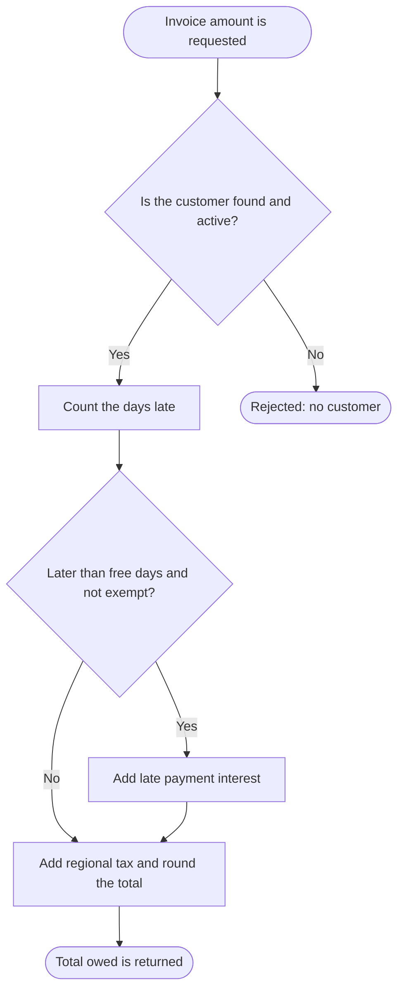

# 2.1 Amount owed on an invoice

Part of [SAMPLE - business logic](../SAMPLE-business-logic.md). Every id on this page is a link.

## Overview

Works out the total a customer owes on one invoice. It adds late payment interest when the invoice is paid late enough, then adds regional tax, and rounds the total to 2 decimals. It rejects unknown or inactive customers.

**Why it exists:** Give the customer a correct total to collect on an invoice, including late payment interest and regional tax. Business team notes state this.

**Starts when:** Each time the amount owed on an invoice is requested, with the customer, amount, due date and processing date.

## Users and roles

| Role | Allowed to |
|---|---|
| Not known from the code | Not known from the code |

*(not known from the code - see questions)*

## Preconditions

- The customer exists in the customer master with status 'A' (active).

## Functional requirements

- **FR-01:** The system shall reject an invoice request with the message "no customer" when no customer with status 'A' is found. ([BR-01](#BR-01)) Second check ☐
- **FR-02:** The system shall treat a failed customer lookup in the same way as a customer that is not found. ([BR-01](#BR-01)) Second check ☐
- **FR-03:** The system shall count the days late as whole days from the due date to the processing date, and as 0 days when the processing date is not after the due date. ([BR-02](#BR-02)) Second check ☐
- **FR-04:** The system shall allow 15 free days for customers of type 'G' and 5 free days for all other customers. ([BR-03](#BR-03)) Second check ☐
- **FR-05:** The system shall add late payment interest only when the days late are more than the free days and the customer is not marked exempt. ([BR-03](#BR-03)) Second check ☐
- **FR-06:** The system shall calculate late payment interest as the invoice amount x the customer's yearly rate / 365 x days late. ([BR-04](#BR-04)) Second check ☐
- **FR-07:** The system shall add regional tax of 18% of the invoice amount for region 1, 5% for region 2, and none for any other region. ([BR-05](#BR-05)) Second check ☐
- **FR-08:** The system shall round the total owed to 2 decimals, with halves rounded up. ([BR-05](#BR-05)) Second check ☐

## Business rules

### BR-01 - Only active customers are processed

**What it does:** Reads the customer's type, yearly rate, region and exempt flag from the customer master. Only customers with status 'A' are found. If none is found, or the read fails, the request is rejected.

**When it applies:**
- Every time an invoice amount is requested.

**How the value is calculated:** No calculation

**Example:**
- Input: Customer id = C999
- Input: Customer status = no active row
- Step: Lookup returns no row
- Step: Request is rejected with "no customer"
- Result: **Error: no customer**

**Exceptions:**
- A database error also gives 'no customer', so the user cannot tell the two cases apart.

Needed by: [FR-01](#FR-01), [FR-02](#FR-02). Used in: [SC-01](#SC-01), [SC-02](#SC-02), [SC-03](#SC-03). Code: [appendix A](../SAMPLE-business-logic.md#trace-BR-01). Code-checked ✔ / Second check ☐ / SME confirmed ☐  — **UNCLEAR, see open questions**

Business reason and the origin of each value

**Business reason:** Amounts are calculated only for active customers. A database failure is handled as 'not found'. *(worked out from the code - to be confirmed by the SME)*

| Value | Comes from | Exact value, column or formula |
|---|---|---|
| Customer id | Given as input | Id of the customer on the invoice |
| Customer status | Read from the database | CUST_MASTER.STS must be 'A' |
| Customer type | Read from the database | CUST_MASTER.TYP |
| Yearly rate | Read from the database | CUST_MASTER.RT |
| Region | Read from the database | CUST_MASTER.REG |
| Exempt flag | Read from the database | CUST_MASTER.EXEMPT_FLG ('Y' means exempt) |

### BR-02 - Count whole days late

**What it does:** Counts how many whole days the processing date is after the due date. Gives 0 when the processing date is the same or earlier.

**When it applies:**
- Every time an invoice amount is requested for an active customer.

**How the value is calculated:** (Processing date - due date) in milliseconds / 86,400,000, whole days only. 0 if the difference is 0 or less.

**Example:**
- Input: Due date = 2026-01-01 00:00
- Input: Processing date = 2026-01-31 18:00
- Step: Difference = 30 days 18 hours
- Step: Whole days only: 30
- Result: **Days late = 30**

**Exceptions:**
- The time of day counts: 29 days 23 hours gives 29 days, not 30.

Needed by: [FR-03](#FR-03). Used in: [SC-01](#SC-01), [SC-02](#SC-02). Code: [appendix A](../SAMPLE-business-logic.md#trace-BR-02). Code-checked ✔ / Second check ☐ / SME confirmed ☐

Business reason and the origin of each value

**Business reason:** Interest depends on the number of days the payment is late. *(worked out from the code - to be confirmed by the SME)*

| Value | Comes from | Exact value, column or formula |
|---|---|---|
| Due date | Given as input | Due date of the invoice |
| Processing date | Given as input | Date the amount is requested for |
| Milliseconds in a day | Fixed in the code | 86400000 |
| Days late | Calculated | (processing date - due date) / 86,400,000, whole days |

### BR-03 - When late payment interest is due

**What it does:** Gives government customers (type 'G') 15 free days and others 5 free days. Interest is due only when days late are more than the free days and the customer is not exempt.

**When it applies:**
- The customer is active.
- Days late are more than the free days.
- The customer is not marked exempt.

**How the value is calculated:** No calculation

**Example:**
- Input: Customer type = G
- Input: Days late = 10
- Input: Exempt = No
- Step: Type 'G': 15 free days
- Step: 10 is not more than 15
- Step: No interest
- Result: **No interest is added**

**Exceptions:**
- Exactly 5 days late (15 for type 'G') gives no interest.

Needed by: [FR-04](#FR-04), [FR-05](#FR-05). Used in: [SC-01](#SC-01), [SC-02](#SC-02). Code: [appendix A](../SAMPLE-business-logic.md#trace-BR-03). Code-checked ✔ / Second check ☐ / SME confirmed ☐

Business reason and the origin of each value

**Business reason:** Short delays are not charged, and exempt customers are never charged interest. *(worked out from the code - to be confirmed by the SME)*

| Value | Comes from | Exact value, column or formula |
|---|---|---|
| Customer type | Read from the database | CUST_MASTER.TYP |
| Free days, type 'G' | Fixed in the code | 15 |
| Free days, other types | Fixed in the code | 5 |
| Exempt flag | Read from the database | CUST_MASTER.EXEMPT_FLG = 'Y' |
| Days late | Calculated | From the day count rule |

### BR-04 - Late payment interest amount

**What it does:** Calculates simple interest on the invoice amount for the days late, using the customer's yearly rate, and adds it to the total.

**When it applies:**
- Interest is due under the rule on when late payment interest is due.

**How the value is calculated:** Yearly rate / 365, rounded to 10 decimals (halves up), x invoice amount x days late. The interest itself is not rounded here.

**Example:**
- Input: Invoice amount = 10,000.00
- Input: Yearly rate = 0.12
- Input: Days late = 30
- Step: 0.12 / 365 = 0.0003287671 per day
- Step: 10,000.00 x 0.0003287671 = 3.287671
- Step: 3.287671 x 30 = 98.63013
- Result: **Interest = 98.63013 (98.63 after final rounding)**

Needed by: [FR-06](#FR-06). Used in: [SC-01](#SC-01). Code: [appendix A](../SAMPLE-business-logic.md#trace-BR-04). Code-checked ✔ / Second check ☐ / SME confirmed ☐  — **UNCLEAR, see open questions**

Business reason and the origin of each value

**Business reason:** Customers who pay late are charged interest for the delay. Business team notes state late payment interest is calculated.

| Value | Comes from | Exact value, column or formula |
|---|---|---|
| Invoice amount | Given as input | Amount of the invoice |
| Yearly rate | Read from the database | CUST_MASTER.RT |
| Days in a year | Fixed in the code | 365 |
| Rate per day | Calculated | Yearly rate / 365, 10 decimals |
| Interest | Calculated | Invoice amount x rate per day x days late |

### BR-05 - Regional tax and rounded total

**What it does:** Adds regional tax on the invoice amount: 18% for region 1, 5% for region 2, none for other regions. Then rounds the total to 2 decimals.

**When it applies:**
- Always, for every active customer, whether the invoice is late or not.

**How the value is calculated:** Total = invoice amount + interest (if due) + invoice amount x tax rate for the region. Rounded to 2 decimals, halves up. Tax is on the invoice amount only, not on interest.

**Example:**
- Input: Invoice amount = 2,000.00
- Input: Region = 2
- Input: Interest = 0
- Step: Tax = 2,000.00 x 0.05 = 100.00
- Step: Total = 2,000.00 + 0 + 100.00 = 2,100.00
- Result: **Total = 2,100.00**

**Exceptions:**
- Exempt customers still pay regional tax; the exempt flag only stops interest.

Needed by: [FR-07](#FR-07), [FR-08](#FR-08). Used in: [SC-01](#SC-01), [SC-02](#SC-02). Code: [appendix A](../SAMPLE-business-logic.md#trace-BR-05). Code-checked ✔ / Second check ☐ / SME confirmed ☐  — **UNCLEAR, see open questions**

Business reason and the origin of each value

**Business reason:** Regional tax is added to what the customer owes. Business team notes state this. Meaning of the region codes is not shown.

| Value | Comes from | Exact value, column or formula |
|---|---|---|
| Region | Read from the database | CUST_MASTER.REG |
| Tax rate, region 1 | Fixed in the code | 0.18 |
| Tax rate, region 2 | Fixed in the code | 0.05 |
| Tax rate, other regions | Fixed in the code | 0 |
| Total | Calculated | Invoice amount + interest + tax, 2 decimals |

## Main flow

Second check of the diagram: ☐

**SC-01 - Invoice paid late, interest and tax added**

When:
- The customer is active and not exempt.
- The invoice is more than the free days late.

Steps:
1. Invoice amount is requested
2. Is the customer found and active?
3. Count the days late
4. Later than free days and not exempt?
5. Add late payment interest
6. Add regional tax and round the total
7. Total owed is returned

Outcome: The total is the invoice amount plus interest plus regional tax, rounded to 2 decimals.

Example:
- Input: Invoice amount = 10,000.00
- Input: Yearly rate = 12% (0.12)
- Input: Days late = 30
- Input: Customer type = not G
- Input: Region = 1
- Step: 30 is more than 5 free days, customer not exempt
- Step: Interest = 10,000.00 x (0.12 / 365) x 30 = 98.63013
- Step: Tax = 10,000.00 x 0.18 = 1,800.00
- Step: Total = 10,000.00 + 98.63013 + 1,800.00 = 11,898.63013
- Result: **Total = 11,898.63**

Rules used: [BR-01](#BR-01), [BR-02](#BR-02), [BR-03](#BR-03), [BR-04](#BR-04), [BR-05](#BR-05). Second check ☐

## Alternate and exception flows

| Scenario | Type | When | Outcome | What the user sees | Rules |
|---|---|---|---|---|---|
| SC-02 Invoice not late enough or customer exempt | Alternate | The customer is active.; The days late do not exceed the free days, or the customer is exempt. | No interest is added. The total is the invoice amount plus regional tax. | The total owed, rounded to 2 decimals, with no interest. | [BR-01](#BR-01), [BR-02](#BR-02), [BR-03](#BR-03), [BR-05](#BR-05) |
| SC-03 Customer not found or inactive | Exception | No customer with this id has status 'A', or the customer lookup fails. | The request is rejected and no total is calculated. | An error with the message text "no customer". | [BR-01](#BR-01) |

SC-02 - steps and worked example

When:
- The customer is active.
- The days late do not exceed the free days, or the customer is exempt.

Steps:
1. Invoice amount is requested
2. Is the customer found and active?
3. Count the days late
4. Later than free days and not exempt?
5. Add regional tax and round the total
6. Total owed is returned

Outcome: No interest is added. The total is the invoice amount plus regional tax.

Example:
- Input: Invoice amount = 2,000.00
- Input: Days late = 10
- Input: Customer type = G
- Input: Region = 2
- Step: Government customer: 15 free days
- Step: 10 is not more than 15, so no interest
- Step: Tax = 2,000.00 x 0.05 = 100.00
- Result: **Total = 2,100.00**

Rules used: [BR-01](#BR-01), [BR-02](#BR-02), [BR-03](#BR-03), [BR-05](#BR-05). Second check ☐

SC-03 - steps and worked example

When:
- No customer with this id has status 'A', or the customer lookup fails.

Steps:
1. Invoice amount is requested
2. Is the customer found and active?
3. Rejected: no customer

Outcome: The request is rejected and no total is calculated.

Example:
- Input: Customer id = C999 (not in the customer master)
- Input: Invoice amount = 500.00
- Step: Lookup finds no active customer
- Step: Request is rejected
- Result: **Error: no customer**

Rules used: [BR-01](#BR-01). Second check ☐

## Inputs and outputs

**Inputs:**
- Customer id
- Invoice amount
- Due date
- Processing date

**Outputs:**
- Total amount owed, rounded to 2 decimals

**How it can end:**
- Rejected: no customer
- Total owed is returned

## Open questions

- Amount owed on an invoice: Who or what starts this calculation: a user screen, a batch job or another system?
- BR-01: Is it right that a database failure is reported as 'no customer', or should it be a separate error?
- BR-04: Is the yearly rate stored as a decimal (0.12 for 12%)? The code uses it as is, without dividing by 100.
- BR-05: What do region codes 1 and 2 stand for, and should other regions really pay no tax?
