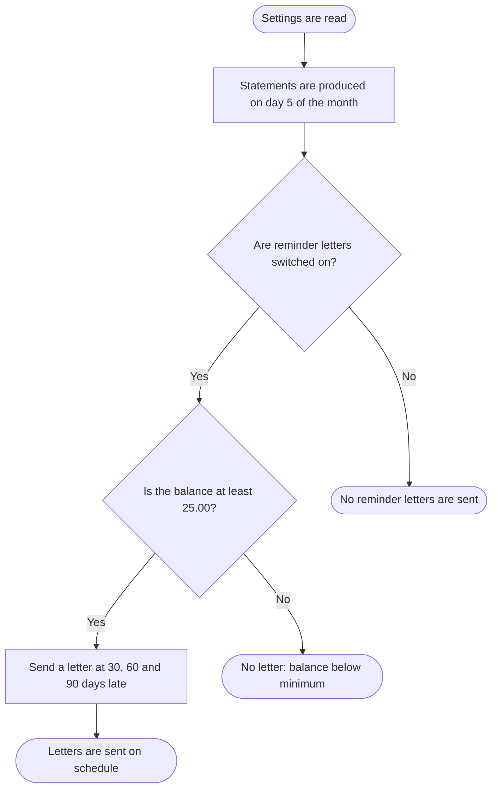

# 2.3 Statement day and reminder letter settings

Part of [SAMPLE - business logic](../SAMPLE-business-logic.md). Every id on this page is a link.

> **DRAFT - NOT READY TO USE AS REQUIREMENTS.** This feature has not passed the second check (state: EXTRACTED). It may be wrong.

## Overview

Settings fix the day of the month for customer statements and control reminder letters: whether they are sent, the smallest balance that gets one, and the days late at which letters go out.

**Why it exists:** Lets the business set when statements are produced and when overdue customers are reminded, without changing code. The business team describes these as reminder letter settings.

**Starts when:** Each time the accounts receivable module reads its settings, for statements and reminder letters.

## Users and roles

| Role | Allowed to |
|---|---|
| Not known from the code | Not known from the code |

*(not known from the code - see questions)*

## Preconditions

- None found in the code.

## Functional requirements

- **FR-09:** The system shall produce customer statements on day 5 of each month. ([BR-06](#BR-06)) Second check ☐
- **FR-10:** The system shall send reminder letters only when the reminder letter switch is on. ([BR-07](#BR-07)) Second check ☐
- **FR-11:** The system shall not send a reminder letter for a balance below 25.00. ([BR-08](#BR-08)) Second check ☐
- **FR-12:** The system shall send reminder letters at 30, 60 and 90 days late. ([BR-09](#BR-09)) Second check ☐

## Business rules

### BR-06 - Statement day of the month

**What it does:** Sets day 5 of each month as the day customer statements are produced.

**When it applies:**
- Every month.

**How the value is calculated:** No calculation

**Example:**
- Input: Month = March
- Step: Setting is 5
- Step: Statements are produced on 5 March
- Result: **Statement day = 5 March**

Needed by: [FR-09](#FR-09). Used in: [SC-05](#SC-05), [SC-06](#SC-06), [SC-07](#SC-07). Code: [appendix A](../SAMPLE-business-logic.md#trace-BR-06). Code-checked ✔ / Second check ☐ / SME confirmed ☐  — **UNCLEAR, see open questions**

Business reason and the origin of each value

**Business reason:** Statements go out on one fixed day each month. The setting name suggests this; no comment confirms it. *(worked out from the code - to be confirmed by the SME)*

| Value | Comes from | Exact value, column or formula |
|---|---|---|
| Statement day of month | Set in a configuration file | ar.statement.day.of.month=5 |

### BR-07 - Reminder letters on or off

**What it does:** Switches reminder letters on (true) or off for all customers.

**When it applies:**
- Before any reminder letter is considered.

**How the value is calculated:** No calculation

**Example:**
- Input: Switch = true
- Step: Switch is true, so letters are allowed
- Result: **Letters can be sent**

Needed by: [FR-10](#FR-10). Used in: [SC-05](#SC-05), [SC-06](#SC-06), [SC-07](#SC-07). Code: [appendix A](../SAMPLE-business-logic.md#trace-BR-07). Code-checked ✔ / Second check ☐ / SME confirmed ☐  — **UNCLEAR, see open questions**

Business reason and the origin of each value

**Business reason:** The business team says the module holds the reminder letter settings. Why a switch is needed is not stated. *(not known from the code - see questions)*

| Value | Comes from | Exact value, column or formula |
|---|---|---|
| Reminder letters enabled | Set in a configuration file | ar.dunning.enabled=true |

### BR-08 - Minimum balance for a reminder letter

**What it does:** Sets 25.00 as the balance below which no reminder letter is sent.

**When it applies:**
- Reminder letters are switched on.

**How the value is calculated:** No calculation

**Example:**
- Input: Balance = 25.00
- Step: Setting is 25.00
- Step: 25.00 against 25.00: whether it counts is not known
- Result: **Not known from the code**

Needed by: [FR-11](#FR-11). Used in: [SC-05](#SC-05), [SC-07](#SC-07). Code: [appendix A](../SAMPLE-business-logic.md#trace-BR-08). Code-checked ✔ / Second check ☐ / SME confirmed ☐  — **UNCLEAR, see open questions**

Business reason and the origin of each value

**Business reason:** Not known from the code. It probably avoids letters for very small balances, but this is not shown. *(not known from the code - see questions)*

| Value | Comes from | Exact value, column or formula |
|---|---|---|
| Minimum balance for a letter | Set in a configuration file | ar.dunning.min.balance=25.00 |
| Customer balance | From another module | Amount the customer owes |

### BR-09 - Days late at which letters are sent

**What it does:** Sets three letter points: 30, 60 and 90 days late.

**When it applies:**
- Reminder letters are switched on.
- The balance is not below the minimum.

**How the value is calculated:** No calculation

**Example:**
- Input: Days late = 90
- Step: Letter points are 30, 60, 90
- Step: 90 is the third point
- Result: **Third letter is due**

Needed by: [FR-12](#FR-12). Used in: [SC-05](#SC-05). Code: [appendix A](../SAMPLE-business-logic.md#trace-BR-09). Code-checked ✔ / Second check ☐ / SME confirmed ☐  — **UNCLEAR, see open questions**

Business reason and the origin of each value

**Business reason:** Not known from the code. Letters at growing delays suggest escalating reminders, but this is not shown. *(not known from the code - see questions)*

| Value | Comes from | Exact value, column or formula |
|---|---|---|
| Days late for letters | Set in a configuration file | ar.dunning.letter.after.days=30,60,90 |

## Main flow

Second check of the diagram: ☐

**SC-05 - Reminder letters sent at 30, 60 and 90 days**

When:
- Reminder letters are switched on.
- The balance is at least 25.00.

Steps:
1. Settings are read
2. Statements are produced on day 5 of the month
3. Are reminder letters switched on?
4. Is the balance at least 25.00?
5. Send a letter at 30, 60 and 90 days late
6. Letters are sent on schedule

Outcome: The customer gets a letter at each of 30, 60 and 90 days late.

Example:
- Input: Balance = 120.00
- Input: Days late = 60
- Step: Letters are on
- Step: 120.00 is not below 25.00
- Step: Letters are due at 30, 60, 90 days
- Step: 60 days late: the second letter is due
- Result: **Second reminder letter is sent**

Rules used: [BR-06](#BR-06), [BR-07](#BR-07), [BR-08](#BR-08), [BR-09](#BR-09). Second check ☐

## Alternate and exception flows

| Scenario | Type | When | Outcome | What the user sees | Rules |
|---|---|---|---|---|---|
| SC-06 Reminder letters switched off | Alternate | The reminder letter switch is set to false. | No reminder letters are sent to any customer. | Not known from the code | [BR-06](#BR-06), [BR-07](#BR-07) |
| SC-07 Balance too small for a letter | Alternate | Reminder letters are switched on.; The balance is below 25.00. | The customer is not sent a reminder letter. | Not known from the code | [BR-06](#BR-06), [BR-07](#BR-07), [BR-08](#BR-08) |

SC-06 - steps and worked example

When:
- The reminder letter switch is set to false.

Steps:
1. Settings are read
2. Statements are produced on day 5 of the month
3. Are reminder letters switched on?
4. No reminder letters are sent

Outcome: No reminder letters are sent to any customer.

Example:
- Input: Letters switch = false
- Input: Balance = 500.00
- Input: Days late = 30
- Step: Letters are off
- Result: **No letter is sent**

Rules used: [BR-06](#BR-06), [BR-07](#BR-07). Second check ☐

SC-07 - steps and worked example

When:
- Reminder letters are switched on.
- The balance is below 25.00.

Steps:
1. Settings are read
2. Statements are produced on day 5 of the month
3. Are reminder letters switched on?
4. Is the balance at least 25.00?
5. No letter: balance below minimum

Outcome: The customer is not sent a reminder letter.

Example:
- Input: Balance = 20.00
- Input: Days late = 30
- Step: Letters are on
- Step: 20.00 is below 25.00
- Result: **No letter is sent**

Rules used: [BR-06](#BR-06), [BR-07](#BR-07), [BR-08](#BR-08). Second check ☐

## Inputs and outputs

**Inputs:**
- Statement day of month setting
- Reminder letters on/off setting
- Minimum balance setting
- Letter days setting
- Customer balance
- Days late

**Outputs:**
- Day of the month for statements
- Decision whether a reminder letter is sent
- Days late at which each letter is sent

**How it can end:**
- No reminder letters are sent
- No letter: balance below minimum
- Letters are sent on schedule

## Open questions

- Statement day and reminder letter settings: Which program reads these settings? No code in this module uses them, so how they are applied is not shown.
- BR-06: What happens when day 5 is a weekend or holiday? Is the statement run moved?
- BR-07: Why can letters be switched off, and who decides? No code in this module reads the switch.
- BR-08: Is a balance of exactly 25.00 sent a letter? What currency is the limit in, and is it per invoice or per customer?
- BR-09: Are the days counted from the invoice date or the due date? Is the wording of each letter different?
