# 2.4 Write off small balances and deactivate dormant customers

Part of [SAMPLE - business logic](../SAMPLE-business-logic.md). Every id on this page is a link.

## Overview

A nightly run writes off small, long-overdue open invoices, but stops and undoes everything if more than 1,000 would be written off. A separate script marks customers inactive when they have had no invoice for 36 months.

**Why it exists:** Clean up balances too small to chase and customers who no longer trade. The business team states small old balances are written off; the reason for deactivating customers is not known from the code.

**Starts when:** The nightly write-off procedure is run with a run date; the customer script is run on its own, with no trigger shown in the code.

## Users and roles

| Role | Allowed to |
|---|---|
| Not known from the code | Not known from the code |

*(not known from the code - see questions)*

## Preconditions

- The run date is supplied to the write-off procedure.
- Invoices and customers exist in the accounts receivable tables.

## Functional requirements

- **FR-13:** The system shall write off an open invoice when its balance is above 0 and at most 2.50 and its due date is more than 90 days before the run date. ([BR-10](#BR-10)) Second check ☐
- **FR-14:** The system shall mark a written-off invoice with status W and the run date as its write-off date. ([BR-10](#BR-10)) Second check ☐
- **FR-15:** The system shall undo all write-offs of a run and raise the error 'too many write-offs' when more than 1,000 invoices would be written off. ([BR-11](#BR-11)) Second check ☐
- **FR-16:** The system shall undo all write-offs of a run and pass the error on to the caller when any error occurs during the write-off. ([BR-12](#BR-12)) Second check ☐
- **FR-17:** The system shall mark an active customer as inactive when the customer's last invoice date is more than 36 months before today. ([BR-13](#BR-13)) Second check ☐

## Business rules

### BR-10 - Write off small old open invoices

**What it does:** Marks open invoices as written off when the balance is small and the invoice is more than 90 days past its due date, then saves the change.

**When it applies:**
- The invoice status is O (open).
- The balance is above 0.
- The balance is at most 2.50.
- The due date is before the run date minus 90 days.

**How the value is calculated:** No calculation. Cut-off due date = run date - 90 days. Status becomes W and write-off date becomes the run date.

**Example:**
- Input: Run date = 2026-10-13
- Input: Balance = 1.80
- Input: Due date = 2026-07-01
- Input: Status = O
- Step: Cut-off = 2026-10-13 minus 90 days = 2026-07-15
- Step: 1.80 is above 0 and at most 2.50
- Step: 2026-07-01 is before 2026-07-15
- Result: **Status W, write-off date 2026-10-13**

**Exceptions:**
- An invoice due exactly on the cut-off date is not written off.
- A balance of exactly 2.50 is written off.

Needed by: [FR-13](#FR-13), [FR-14](#FR-14). Used in: [SC-08](#SC-08), [SC-09](#SC-09), [SC-10](#SC-10). Code: [appendix A](../SAMPLE-business-logic.md#trace-BR-10). Code-checked ✔ / Second check ☐ / SME confirmed ☐  — **UNCLEAR, see open questions**

Business reason and the origin of each value

**Business reason:** Small old balances are cleaned up because they are not worth collecting. Stated by the code comment 'Nightly clean-up of small balances' and the business team notes.

| Value | Comes from | Exact value, column or formula |
|---|---|---|
| Run date | Given as input | Date given to the procedure |
| Write-off limit | Fixed in the code | 2.50 |
| Days overdue before write-off | Fixed in the code | 90 |
| Open status | Read from the database | AR_INVOICE.STS = 'O' |
| Invoice balance | Read from the database | AR_INVOICE.BAL_AMT |
| Due date | Read from the database | AR_INVOICE.DUE_DT |
| Written-off status | Fixed in the code | 'W' stored in AR_INVOICE.STS |
| Write-off date | Calculated | AR_INVOICE.WRITEOFF_DT = run date |

### BR-11 - Cap of 1,000 write-offs per run

**What it does:** If more than 1,000 invoices were written off in one run, undoes them all and stops with the error 'too many write-offs'. Otherwise saves.

**When it applies:**
- More than 1,000 invoices were updated by the write-off.

**How the value is calculated:** No calculation. The count of updated invoices is compared with 1,000.

**Example:**
- Input: Invoices qualifying = 1,001
- Step: 1,001 is more than 1,000
- Step: All 1,001 write-offs are undone
- Step: Error 'too many write-offs' is raised
- Result: **No invoice written off**

**Exceptions:**
- Exactly 1,000 write-offs is allowed and saved.

Needed by: [FR-15](#FR-15). Used in: [SC-08](#SC-08), [SC-09](#SC-09). Code: [appendix A](../SAMPLE-business-logic.md#trace-BR-11). Code-checked ✔ / Second check ☐ / SME confirmed ☐  — **UNCLEAR, see open questions**

Business reason and the origin of each value

**Business reason:** Not known from the code. It may protect against a wrong mass write-off. *(not known from the code - see questions)*

| Value | Comes from | Exact value, column or formula |
|---|---|---|
| Invoices written off in this run | Calculated | Number of rows updated by the write-off |
| Maximum write-offs per run | Fixed in the code | 1000 |
| Error number | Fixed in the code | -20001 |
| Error text | Fixed in the code | too many write-offs |

### BR-12 - Any error undoes the write-offs

**What it does:** If any error happens during the write-off, undoes all changes of the run and passes the same error to the caller.

**When it applies:**
- Any error occurs while the write-off procedure runs.

**How the value is calculated:** No calculation

**Example:**
- Input: Event = Database error during the update
- Step: Changes are undone
- Step: The same error is raised to the caller
- Result: **No invoice written off; caller receives the error**

Needed by: [FR-16](#FR-16). Used in: [SC-08](#SC-08), [SC-09](#SC-09), [SC-10](#SC-10). Code: [appendix A](../SAMPLE-business-logic.md#trace-BR-12). Code-checked ✔ / Second check ☐ / SME confirmed ☐

Business reason and the origin of each value

**Business reason:** Not known from the code. It keeps invoices from being left partly written off. *(worked out from the code - to be confirmed by the SME)*

| Value | Comes from | Exact value, column or formula |
|---|---|---|
| Error | From the system | The error raised by the database or by the cap rule |

### BR-13 - Deactivate customers with no invoice for 36 months

**What it does:** Changes the status of active customers to inactive when their last invoice is more than 36 months before today's date.

**When it applies:**
- The customer status is A (active).
- The last invoice date is before today minus 36 months.

**How the value is calculated:** Cut-off date = today's system date minus 36 months. Status A becomes I.

**Example:**
- Input: Today = 2026-10-13
- Input: Status = A
- Input: Last invoice date = 2023-06-30
- Step: Cut-off = 2026-10-13 minus 36 months = 2023-10-13
- Step: 2023-06-30 is before 2023-10-13
- Result: **Status changes from A to I**

**Exceptions:**
- A customer with no last invoice date is never deactivated.
- Customers already inactive are not changed.

Needed by: [FR-17](#FR-17). Used in: [SC-11](#SC-11). Code: [appendix A](../SAMPLE-business-logic.md#trace-BR-13). Code-checked ✔ / Second check ☐ / SME confirmed ☐  — **UNCLEAR, see open questions**

Business reason and the origin of each value

**Business reason:** Not known from the code. The business team notes do not mention this behaviour. *(not known from the code - see questions)*

| Value | Comes from | Exact value, column or formula |
|---|---|---|
| Today's date | From the system | System date |
| Months without invoice | Fixed in the code | 36 |
| Customer status | Read from the database | CUST_MASTER.STS |
| Last invoice date | Read from the database | CUST_MASTER.LAST_INV_DT |
| Active / inactive codes | Fixed in the code | 'A' / 'I' |

## Main flow

```mermaid
flowchart TD
    S1(["Nightly write-off starts with a run date"])
    S2["Write off small open invoices overdue over 90 days"]
    S3{"Did the update finish without error?"}
    S4{"More than 1,000 invoices written off?"}
    S5["Save the write-offs"]
    E1(["Rejected: write-offs undone, error raised"])
    E2(["Small balances are written off"])
    E3(["Failed: changes undone, error passed on"])
    S6(["Customer clean-up script runs"])
    S7["Mark active customers with no invoice for 36 months inactive"]
    E4(["Dormant customers are marked inactive"])
    S1 --> S2
    S2 --> S3
    S3 -->|"Yes"| S4
    S3 -->|"No"| E3
    S4 -->|"Yes"| E1
    S4 -->|"No"| S5
    S5 --> E2
    S6 --> S7
    S7 --> E4
```

Second check of the diagram: ☐

**SC-08 - Small old balances written off**

When:
- Open invoices with a balance up to 2.50 are more than 90 days overdue.
- 1,000 or fewer invoices qualify.

Steps:
1. Nightly write-off starts with a run date
2. Write off small open invoices overdue over 90 days
3. Did the update finish without error?
4. More than 1,000 invoices written off?
5. Save the write-offs
6. Small balances are written off

Outcome: Qualifying invoices are marked written off with the run date and the change is saved.

Example:
- Input: Run date = 2026-10-13
- Input: Invoice A = open, balance 1.80, due 2026-07-01
- Input: Invoice B = open, balance 2.51, due 2026-07-01
- Step: Cut-off due date = 2026-10-13 minus 90 days = 2026-07-15
- Step: A: 1.80 is above 0 and at most 2.50; due 2026-07-01 is before 2026-07-15, so A qualifies
- Step: B: 2.51 is above 2.50, so B is left open
- Step: Count written off = 1, not above 1,000, so changes are saved
- Result: **Invoice A: status W, write-off date 2026-10-13. Invoice B unchanged.**

Rules used: [BR-10](#BR-10), [BR-12](#BR-12), [BR-11](#BR-11). Second check ☐

## Alternate and exception flows

| Scenario | Type | When | Outcome | What the user sees | Rules |
|---|---|---|---|---|---|
| SC-09 Too many write-offs, run rejected | Exception | More than 1,000 invoices qualify for write-off. | All write-offs from this run are undone and the run stops with an error. | Error -20001 with the text 'too many write-offs'. | [BR-10](#BR-10), [BR-12](#BR-12), [BR-11](#BR-11) |
| SC-10 Database error during write-off | Exception | Any error occurs while the write-off runs. | Changes are undone and the original error is passed to the caller. | The original database error; its text is not known from the code. | [BR-10](#BR-10), [BR-12](#BR-12) |
| SC-11 Dormant customer marked inactive | Alternate | The customer is active.; The last invoice is more than 36 months before today. | The customer's status is changed from active to inactive. | Not known from the code | [BR-13](#BR-13) |

SC-09 - steps and worked example

When:
- More than 1,000 invoices qualify for write-off.

Steps:
1. Nightly write-off starts with a run date
2. Write off small open invoices overdue over 90 days
3. Did the update finish without error?
4. More than 1,000 invoices written off?
5. Rejected: write-offs undone, error raised

Outcome: All write-offs from this run are undone and the run stops with an error.

Example:
- Input: Run date = 2026-10-13
- Input: Qualifying invoices = 1,001
- Step: 1,001 invoices are updated
- Step: 1,001 is more than 1,000
- Step: Changes are undone and the error is raised
- Result: **No invoice is written off; error 'too many write-offs'.**

Rules used: [BR-10](#BR-10), [BR-12](#BR-12), [BR-11](#BR-11). Second check ☐

SC-10 - steps and worked example

When:
- Any error occurs while the write-off runs.

Steps:
1. Nightly write-off starts with a run date
2. Write off small open invoices overdue over 90 days
3. Did the update finish without error?
4. Failed: changes undone, error passed on

Outcome: Changes are undone and the original error is passed to the caller.

Example:
- Input: Run date = 2026-10-13
- Input: Event = Database error while updating
- Step: Update fails
- Step: Changes are undone
- Step: The same error is raised again
- Result: **No invoice is written off; the caller receives the error.**

Rules used: [BR-10](#BR-10), [BR-12](#BR-12). Second check ☐

SC-11 - steps and worked example

When:
- The customer is active.
- The last invoice is more than 36 months before today.

Steps:
1. Customer clean-up script runs
2. Mark active customers with no invoice for 36 months inactive
3. Dormant customers are marked inactive

Outcome: The customer's status is changed from active to inactive.

Example:
- Input: Today = 2026-10-13
- Input: Customer status = A
- Input: Last invoice date = 2023-06-30
- Step: Cut-off = 2026-10-13 minus 36 months = 2023-10-13
- Step: 2023-06-30 is before 2023-10-13
- Step: Customer is active, so it qualifies
- Result: **Customer status = I**

Rules used: [BR-13](#BR-13). Second check ☐

## Inputs and outputs

**Inputs:**
- Run date
- Open invoices (status, balance, due date)
- Customers (status, last invoice date)
- Today's system date

**Outputs:**
- Invoices marked written off, with the write-off date
- Customers marked inactive
- Error 'too many write-offs' when the cap is exceeded

**How it can end:**
- Rejected: write-offs undone, error raised
- Small balances are written off
- Failed: changes undone, error passed on
- Dormant customers are marked inactive

## Open questions

- Write off small balances and deactivate dormant customers: Who or what starts the nightly write-off and the customer script, and at what time?
- Write off small balances and deactivate dormant customers: Is the customer script meant to be part of the nightly run, and is its result saved afterwards?
- BR-10: What currency is the 2.50 limit in, and is it right for every customer and region?
- BR-10: Should the 90 days count from the due date as the code does, or from the invoice date?
- BR-11: Why is the cap 1,000, and what should happen when it is exceeded: who is told and how are the invoices handled afterwards?
- BR-13: Is deactivating dormant customers intended, and why 36 months? The change is not saved by this script: who saves it?
- BR-13: Should customers with no last invoice date also be deactivated?
